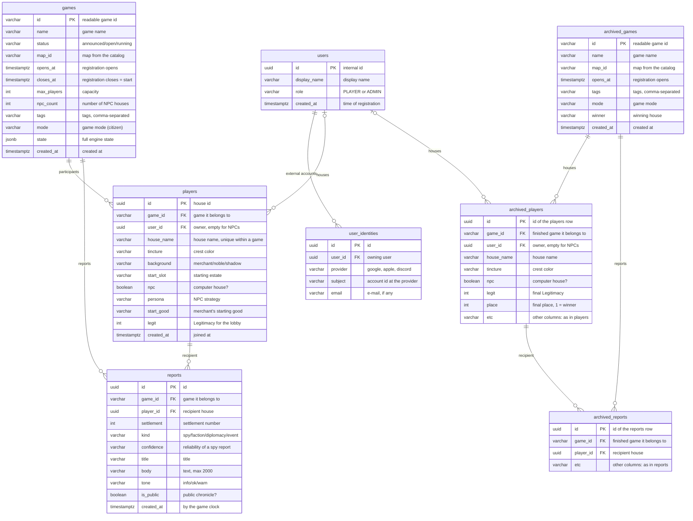
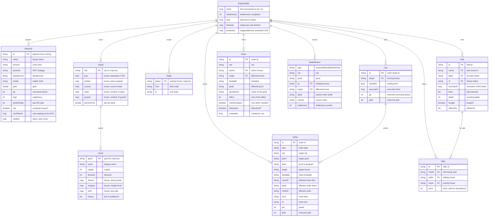

# Database schema

The PostgreSQL schema of the Trón nélkül backend (`tron-nelkul/backend`) after the Flyway V1–V3 migrations, and the internal structure of the `games.state` JSONB column (`engine/EngineState.java`).

- [`tron_nelkul.dbml`](tron_nelkul.dbml): editable ERD with field-level notes. Open it on [dbdiagram.io](https://dbdiagram.io) (new diagram, paste the file's contents); there the tables can be dragged around and the diagram exported as PNG/PDF/SQL.
- The Mermaid diagrams below render on GitHub and in the VS Code Markdown preview, and can also be edited on [mermaid.live](https://mermaid.live).

## Relational tables

## The `games.state` JSONB (EngineState)

These are not real tables: the relationships are string ids and the database does not check them.

